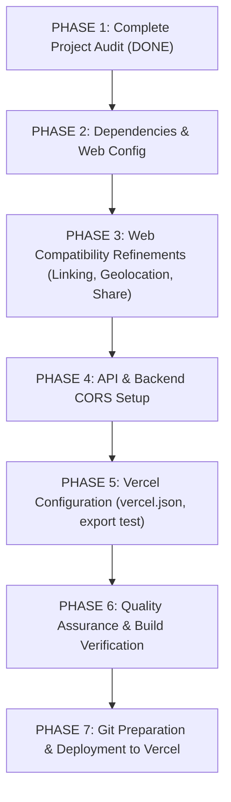

# EXPO WEB COMPATIBILITY REPORT
**Project:** Shree Hari Sweets & Snacks Customer Mobile & Web App  
**Target Platform:** Web (Vercel) & Android (APK)  
**Date:** November 14, 2026  
**Auditor:** Senior React Native Expo & Vercel Specialist  

---

## 1. Executive Summary

This audit assesses the readiness of the existing React Native customer application (`08-11-2026/mobile/AGENTS`) for web deployment on Vercel while preserving the existing Android functionality and maintaining a unified codebase talking to the same cPanel Node.js/Express backend (`https://nice-amethyst-canary.172-235-18-108.cpanel.site/api`) and PostgreSQL database.

The application has been well-architected with modern Expo (SDK 58) patterns, clean separation of concerns, and defensive guards (`Platform.OS === 'web'`) already in place across critical modules (auth token fallback to `AsyncStorage`, notifications exclusion on web, dev/prod API URL resolver). With minimal surgical adjustments (installing dependencies, web title/meta tags, SPA routing/redirects for Vercel, and deep-link/navigation path mapping), the application will run seamlessly on both Android and Web browsers.

---

## 2. Project Architecture & Environment

| Property | Value / Configuration |
| :--- | :--- |
| **Expo SDK Version** | `~58.0.22` (React Native `0.88.1`, React `19.3.0`, React DOM `19.3.0`) |
| **App Name / Slug** | Shree Hari Sweets & Snacks (`shree-hari-sweets-snacks`) |
| **App Scheme** | `shreehari://` |
| **Navigation Stack** | `@react-navigation/native` `^7.5.1`, `@react-navigation/native-stack` `^7.21.0`, `@react-navigation/bottom-tabs` `^7.21.0` |
| **State Management** | `zustand` `^5.0.16` (Auth, Shop/Cart, Catalog, Capabilities, Toast) |
| **Styling & Theming** | Pure StyleSheet + Design Tokens (`src/theme`), `useWindowDimensions` for responsive layout |
| **Bundler Config** | `metro` configured in `app.json` under `expo.web.bundler` |
| **Production Backend** | `https://nice-amethyst-canary.172-235-18-108.cpanel.site/api` (cPanel + Node/Express + PostgreSQL) |
| **Local Dev Backend** | Dynamic host detection: `http://{devHost}:4000/api` |

---

## 3. Dependency Audit & Web Compatibility Matrix

| Package | Version | Web Compatibility | Notes & Action Required |
| :--- | :--- | :---: | :--- |
| `expo` | `~58.0.22` | ✅ Full | Core Expo framework with built-in Web support via Metro. |
| `react` & `react-dom` | `19.3.0` | ✅ Full | Standard React 19 packages installed. |
| `react-native-web` | `^0.21.4` | ✅ Full | Primary bridge rendering React Native primitives to standard HTML/CSS. |
| `@expo/metro-runtime` | `~58.0.16` | ✅ Full | Required for web fast-refresh and runtime execution. |
| `@react-navigation/*` | `^7.x` | ✅ Full | Compatible with Web. Needs URL path mapping for SPA deep linking. |
| `react-native-safe-area-context` | `~5.10.1` | ✅ Full | Fully supported on web (handles browser insets). |
| `react-native-screens` | `~4.30.1` | ✅ Full | Web support included in `react-native-screens`. |
| `react-native-gesture-handler`| `~3.3.0` | ✅ Full | Wrapped with `<GestureHandlerRootView style={{ flex: 1 }}>`. |
| `react-native-reanimated` | `4.7.1` | ✅ Full | Supported on web. Modern animations gracefully adapt. |
| `react-native-svg` | `15.16.0` | ✅ Full | Supported on web via SVG elements. |
| `@expo/vector-icons` | `^15.0.2` | ✅ Full | Font icons render smoothly in web DOM. |
| `@expo-google-fonts/*` | `^0.4.2` | ✅ Full | Web font injection via `@expo-google-fonts` + `expo-font`. |
| `expo-image` | `~58.0.18` | ✅ Full | Optimized web image rendering with fallbacks. |
| `expo-linear-gradient` | `~58.0.3` | ✅ Full | Renders CSS linear gradients on web. |
| `@react-native-async-storage/async-storage` | `2.2.0` | ✅ Full | Uses browser `localStorage` on web. |
| `expo-secure-store` | `~58.0.2` | ⚠️ Native Only | **Already Handled:** `useAuth.ts` uses `Platform.OS === 'web'` to store tokens in `AsyncStorage` instead of `SecureStore`. |
| `expo-haptics` | `~58.0.7` | ⚠️ Native Only | **Already Handled:** `PressableScale.tsx` guards haptics with `if (Platform.OS !== 'web')`. |
| `expo-notifications` | `~58.1.8` | ⚠️ Native Only | **Already Handled:** `notificationPermission.ts` returns `{ ok: false, reason: 'unavailable' }` on web. Web push or in-app notifications inbox can be used. |
| `expo-location` | `~58.0.20` | ⚠️ Native Only | `Location.hasServicesEnabledAsync()` guarded; browser `navigator.geolocation` can be used or fallback to manual address/pincode entry. |
| `expo-speech-recognition`| `^58.0.1` | ⚠️ Native Only | **Already Handled:** Dynamically imported via try/catch in `voiceSearch.ts`. On web it defaults gracefully to manual search typing. |
| `expo-image-picker` | `~58.0.10` | ⚠️ Partial | File picker supported via HTML `<input type="file">` handled by Expo Image Picker for web. |
| `expo-splash-screen` | `~58.0.12` | ✅ Full | Supported in web bundle; splash hidden cleanly after fonts/auth load. |

---

## 4. Screen-by-Screen Web Readiness

| Screen | Native Dependencies | Web Status | Plan / Strategy |
| :--- | :--- | :---: | :--- |
| **SplashScreen** | `expo-splash-screen`, reanimated | ✅ Ready | Smooth fade-out into Home or Login. |
| **OnboardingScreen** | `useWindowDimensions`, FlatList | ✅ Ready | Responsive carousel and guest navigation. |
| **HomeScreen** | Hero carousel, Category pills, Product cards | ✅ Ready | Responsive flex/grid layouts with card width calculation. |
| **CategoriesScreen** | Dual sidebar + category grid | ✅ Ready | Works on desktop and mobile viewports. |
| **SearchScreen** | Voice search, live filter | ✅ Ready | Input typing works; voice mic disabled or falls back to Web Speech API. |
| **ProductDetailScreen**| Image gallery, variant selection, cart add | ✅ Ready | Full responsive product display. |
| **CartScreen** | Cart lines, promo codes, delivery slot | ✅ Ready | Debounced cart sync to backend. |
| **CheckoutScreen** | Address select, delivery instructions | ✅ Ready | Address picker + form modal sheet. |
| **PaymentScreen** | COD / UPI / Simulated Gateway | ✅ Ready | Respects `capabilities.payments`. Razorpay Web SDK or COD. |
| **OrderResultScreen** | Success animation, confetti/check | ✅ Ready | Full SVG/Reanimated support. |
| **OrdersScreen** | Order history list, status badges | ✅ Ready | Data loaded via `api.account.orders()`. |
| **OrderTrackingScreen**| Live timeline, cancel order, call store | ✅ Ready | Responsive layout; telephone & mail links use web standards. |
| **AccountScreen** | Profile, saved addresses, sign out | ✅ Ready | Full customer account management. |
| **AddressesScreen** | Add/edit address, GPS location autofill | ✅ Ready | Browser geolocation autofills lat/long, or manual entry. |
| **LoginScreen** | Password & OTP verification | ✅ Ready | Backend API login with session persistence. |
| **SignupScreen** | Name, phone, email, password | ✅ Ready | Standard form validation. |
| **ForgotPasswordScreen**| Email reset link request | ✅ Ready | Calls `/api/auth/forgot-password`. |
| **ResetPasswordScreen** | Token verification & password reset | ✅ Ready | URL query parameter deep linking: `/reset-password?token=...`. |
| **VerifyEmailScreen** | Token email verification | ✅ Ready | Deep linking: `/verify-email?token=...`. |
| **OffersScreen** | Active coupons, banners, sharing | ✅ Ready | Native `Share` falls back to `navigator.clipboard` or Web Share API. |
| **InboxScreen** | In-app notification center | ✅ Ready | Serves as customer notification hub on Web. |
| **WishlistScreen** | Saved items | ✅ Ready | Local & server synced wishlist. |
| **PhotoManagerScreen** | Camera / Library photo selection | ✅ Ready | HTML file input for web photo uploads. |

---

## 5. API Configuration & cPanel Integration Audit

1. **Environment Variables**:
   - `EXPO_PUBLIC_USE_MOCK=false` (in `.env`)
   - `EXPO_PUBLIC_API_URL_PRODUCTION=https://nice-amethyst-canary.172-235-18-108.cpanel.site/api` (in `.env.production`)
   - Development auto-detects `http://{devHost}:4000/api`.
   - **Finding:** The production backend URL is already explicitly set and properly structured.

2. **Backend CORS Configuration**:
   - `backend/env-backend/src/app.ts`:
     ```ts
     app.use(cors({ origin: env.CORS_ORIGINS.split(',').map((o) => o.trim()), credentials: false }));
     ```
   - In `.env`, `CORS_ORIGINS=http://localhost:8081`.
   - **Crucial Action Required:** Once Vercel generates the production deployment domain (e.g., `https://shreehari-sweets.vercel.app` or custom domain), that origin **must** be appended to `CORS_ORIGINS` in the cPanel backend environment or set to allow the Vercel domain so browser fetch requests are not blocked by CORS preflight (`OPTIONS`).

3. **Security Standards**:
   - No DB credentials or private keys exist in the frontend mobile/web code.
   - All network calls use JWT Bearer tokens held in memory and persisted in `AsyncStorage` on Web.
   - HTTPS is strictly enforced for production release builds.

---

## 6. Vercel Deployment Architecture

- **Build Command:** `npx expo export -p web` (generates static SPA bundle in `dist`)
- **Output Directory:** `dist`
- **Routing:** A single-page application (SPA) needs a `vercel.json` rewrites rule so direct navigation or browser refresh on URLs (e.g., `/reset-password`, `/orders`) routes back to `index.html`.
- **Framework Preset:** `Other` (or Expo / Static HTML)

---

## 7. Implementation Plan



1. **Phase 2 (Dependencies & Config):**
   - Run clean dependency installation in `08-11-2026/mobile/AGENTS`.
   - Verify web settings in `app.json` (title, meta, favicon).
2. **Phase 3 (Feature Refinements):**
   - Enhance `linking` in `App.tsx` to handle browser URL paths cleanly (`/`, `/categories`, `/cart`, `/reset-password`, etc.).
   - Ensure `Share.share` in `OffersScreen` and `ImageGallery` handles Web Share API / clipboard fallback.
   - Ensure `location.ts` supports browser `navigator.geolocation` when on web.
3. **Phase 4 & 5 (Vercel & Build):**
   - Add `vercel.json` with clean SPA rewrite rules and security headers.
   - Run `npx expo export -p web` to generate `dist`.
   - Test production web build locally.
4. **Phase 6 & 7 (Deployment):**
   - Verify Android APK configuration remains completely intact.
   - Guide Vercel git push/connect and environment configuration.
